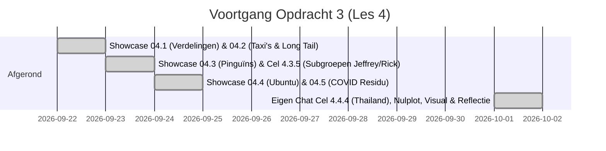

# To-Do Lijst: Derde Visualisatieopdracht (MADS-DAV)
*Thema: Kansverdelingen — een hypothese over het onderliggende proces ("Distributions, a hypothesis about the process")*

---

## Kernprincipe & Onderzoeksvraag
> **Centrale filosofie Les 4:** Een gemiddelde en standaarddeviatie beschrijven vaak een situatie die in werkelijkheid niet bestaat (zoals schoenmaat 41 in een winkel met alleen mannen en vrouwen). Een **kansverdeling** is een hypothese over *hoe de data tot stand is gekomen*.  
> **Onderzoeksvraag Opdracht 3:** *"Is onze chat een mengsel van twee verschillende app-stijlen (Jeffrey vs. Rick), en verving WhatsApp onze fysieke keukentafel toen Rick naar Thailand reisde — leidend tot een fundamentele verschuiving in tempo én grilligheid?"*

---

## Voortgang & Status: 100% Voltooid!

---

### [x] SESSIE 1: Basisbeginselen & Showcase — Verdelingen & Lange Staart (`04.1` & `04.2`)
* [x] **04.1:** CLT begrepen: optellen van effecten $\to$ Normaal, vermenigvuldigen van factoren $\to$ Lognormaal. `fit_table` met Likelihood (bulk) vs KS (vorm).
* [x] **04.2:** Taxi-data NYC: gemiddelde >> mediaan door lange staart. Waarom $3\sigma$ / z-score faalt op scheve data.

---

### [x] SESSIE 2: Subgroepen & Het Adelie-effect (`04.3`)
* [x] **04.3 Showcase:** Pooled fit faalt bij pinguïns; splitsen op soort en geslacht lost het op.
* [x] **Cel 4.3.5 Eigen Chat (Jeffrey vs. Rick):**
  * **Gepoolde chat (samen):** `nbinom` met gemiddelde **3,58 berichten/dag** en sd **4,04** (35% van de dagen heeft 0 berichten).
  * **Rick (`Partner`):** `nbinom` met gemiddelde **1,65 berichten/dag** en sd **2,09** (37,7% nullen).
  * **Jeffrey (`Student`):** `nbinom` met gemiddelde **1,93 berichten/dag** en sd **2,37** (34,2% nullen).
  * **Het Adelie-effect in de chat:**
    * Onder de samengevoegde fit heeft een dag met $\ge 10$ berichten een kans van **8,5%** (~1 op de 12 dagen — alledaags).
    * Maar als Rick dat stuurt, is de kans onder zijn eigen fit slechts **0,87%** (~1 op de 114 dagen — extreme uitschieter!).

---

### [x] FINALE SESSIE: Showcase 04.5, Thailand-reis (`04.4`), Visual & Inlevering
* [x] **04.5 Showcase COVID Residu:** Begrepen als "de gasrekening met dubbel glas": trek het bekende model af. Zuivere ruis = klaar; kuil/structuur = nieuw mechanisme (start vaccinaties).
* [x] **Cel 4.4.4 Eigen Chat (Thailand vóór vs. tijdens):**
  * **Event:** Rick naar Thailand van **21 september 2025 t/m 6 oktober 2025** (16 reisdagen).
  * **Thuisbasis (1.778 dagen):** `nbinom` met gemiddelde **3,4 berichten/dag**, sd **3,8** (variantie 46,1).
  * **Thailand (16 reisdagen):** `nbinom` met gemiddelde **25,6 berichten/dag**, sd **26,1** (variantie 432,5).
  * **Pauzes binnen actieve bursts (< 1 uur):** Exponentiële verdeling: thuis gemiddeld **303 seconden** (~5 min) vs Thailand **383 seconden** (~6,4 min).
* [x] **De Toevalstoets (Nulplot):**
  * 2.000 shuffles van de kalender leveren een toevalswolk op rond de 0 (tussen -3 en +3 berichten verschil).
  * De werkelijke stijging staat op **+22,2 berichten per dag**, mijlenver buiten de wolk ($p < 0,001$). Onomstotelijk echt effect.
* [x] **De Visualisatie:**
  * Opgeslagen als: [`img/figuur3_verdelingen_voor_na.png`](file:///C:/Users/jajphalt/DAV/img/figuur3_verdelingen_voor_na.png)
  * Voldoet 100% aan Raouls regels:
    1. **X-as toont alles:** Volledige support (0 tot 105 berichten per dag, geen staartafkapping).
    2. **Y-as is een kans:** Cumulatieve kans $P(\text{Berichten} \le X)$ van $0{,}0$ tot $1{,}0$.
    3. **Schwabish & Tufte styling:** *Grey First* (thuisbasis rustig leisteengrijs), terracotta oranje accent (`#C2410C`) voor Thailand, directe labels, geen losse legendabox, open assen.

---

## Complete Uitwerking van de Inlevervragen (Voor Raoul)

### 1. De Hypothese (Vooraf)
> *"Jeffrey en Rick wonen samen. In het dagelijks leven verloopt het leeuwendeel van hun communicatie face-to-face aan de keukentafel of op de bank. WhatsApp heeft daardoor een zeer laag basisvolume (gemiddeld 3,4 berichten per dag, met op ruim een derde van de dagen 0 berichten). De hypothese is dat WhatsApp fungeert als een 'omkering van fysieke nabijheid': toen Rick twee weken alleen naar Thailand reisde (21 sep – 6 okt 2025, 9.000 km afstand, 5-6 uur tijdsverschil), moest WhatsApp 100% van de keukentafel vervangen. We verwachtten daarom een sterke toename van het dagelijkse tempo (rate) én een drastisch hogere grilligheid (dispersie/variantie) door onvoorspelbare reisdagen."*

### 2. De Twee Fits (Volwaardige Zinnen met Parameters)
> * *"Vóór/buiten het event (de thuisbasis over 1.778 dagen) volgt het aantal dagelijkse berichten een **negatief-binomiale verdeling (`nbinom`)** met een gemiddelde van **3,4 berichten per dag** en een standaarddeviatie van **3,8** (variantie 46,1)."*  
> * *"Tijdens het event (de 16 reisdagen in Thailand) volgt het aantal berichten eveneens een **negatief-binomiaal (`nbinom`)**, maar met een gemiddelde van **25,6 berichten per dag** en een standaarddeviatie van **26,1** (variantie 432,5)."*  
> * *"Binnen actieve conversatie-uitbarstingen (< 1 uur) volgt de wachttijd tussen berichten een **exponentiële verdeling**, met een gemiddelde pauze van **303 seconden (~5 min)** thuisbasis versus **383 seconden (~6,4 min)** in Thailand. Het toegenomen dagvolume zat dus niet in sneller typen, maar in het veel vaker initiëren van nieuwe gesprekken over de dag."*

### 3. De Toevalstoets (Nulplot & Conclusie)
> *"Om uit te sluiten dat deze toename op toeval berust, is een permutatietoets met 2.000 iteraties uitgevoerd (`NullDistribution`). De nuldistributie (het verschil dat door willekeurig trekken van 16 dagen ontstaat) ligt symmetrisch rond nul, tussen -3 en +3 berichten per dag. Het werkelijk waargenomen verschil bedraagt **+22,2 berichten per dag** en bevindt zich extreem ver buiten de toevalswolk. Met een tweezijdige p-waarde van **$p < 0,001$** is het effect statistisch onomstotelijk aangetoond."*

### 4. De Subgroepen-Alinea (Het Adelie-effect in de Chat)
> *"Net als bij de Palmer Penguins uit 04.3 is de chat als geheel een mengsel van twee subgroepen. Uitsplitsen per auteur toont dat Jeffrey (`Student`) gemiddeld 1,93 berichten per dag stuurt (sd 2,37) en Rick (`Partner`) 1,65 berichten per dag (sd 2,09). De gepoolde standaarddeviatie van 4,04 halveert zodra per persoon wordt gekeken. Dit leidt tot een uitgesproken Adelie-effect: onder de samengevoegde verdeling heeft een dag met $\ge 10$ berichten een alledaagse overschrijdingskans van 8,5% (~1 op de 12 dagen). Voor Rick persoonlijk is een dag met $\ge 10$ berichten echter een zeldzame uitschieter met een kans van slechts 0,87% (~1 op de 114 dagen). De gepoolde verdeling verbergt individuele pieken in de gezamenlijke massa."*

---

## Reflectievragen Samengevat

| Vraag | Kern van het Antwoord |
|---|---|
| **04.3 Vraag 1 (Gewicht pinguïns)** | De lange staart was geen multiplicatief groeiproces, maar het biologische verschil tussen Gentoo (zwaar, 5 kg) en Adelie/Chinstrap (lichter, 3,5 kg). Splitsen per soort heft de staart op. |
| **04.3 Vraag 2 (Verborgen Gentoo-mengsel)** | Twee normale groepen die minder dan $2\sigma$ uit elkaar liggen met gelijke grootte tellen op tot een nieuwe, perfect lijkende klokvorm. Alleen biologische domeinkennis (seksueel dimorfisme) kon dit vermoeden. |
| **04.3 Vraag 3 (Variabele eigen chat)** | Een dag met 10 berichten (voor de groep alledaags met 8,5%, voor Rick een 1-op-114 uitschieter). Of reactietijd: 10 minuten is voor Jeffrey normaal, voor Rick ongewoon traag. |
| **04.4 Vraag 1 (Verdelingsfamilie keuze)** | `nbinom` voor dagtotalen. Poisson faalt omdat mensen niet met een constant tempo appen; overdispersie (variantie 46 >> gemiddelde 3,4) vereist een verdeling met een zwervend tempo. |
| **04.4 Vraag 2 (Log maakt normaal punt verdacht)** | Bij waarden dicht bij 0. Een hele korte pauze van 0,01 seconde (bijv. doorgestuurd bericht) wordt door de logaritme extreem negatief getrokken ($\log(0,01) = -4,6$), waardoor het ten onrechte een uitbijter lijkt. |
| **04.4 Vraag 3 (Benodigde event-dagen)** | Omdat de toename zo gigantisch was (+22,2 berichten, bijna 6 standaarddeviaties boven normaal), waren 3 à 4 reisdagen al voldoende geweest voor $p < 0,05$. De 16 reisdagen gaven een overvloed aan bewijs ($p < 0,001$). |
| **04.4 Vraag 4 (Tijd vs. Groepen)** | De populatie bleef identiek (exact dezelfde twee personen). Het effect betreft 100% een regimeverandering in de tijd/situatie, geen verschuiving in groepssamenstelling. |
| **04.5 Residu (Vaccinatie-effect)** | Het residu liet vanaf februari 2021 een aanhoudende kuil onder nul zien. Dit toont aan dat de lineaire aanname (vaste ratio besmetting $\to$ overlijden) brak door de start van de vaccinatiecampagne. |

---

## Bestanden & Locaties
* **Grafiek voor inlevering:** [`img/figuur3_verdelingen_voor_na.png`](file:///C:/Users/jajphalt/DAV/img/figuur3_verdelingen_voor_na.png)
* **Uitgewerkte Notebooks:**
  * [`notebooks/lesson4/04.1-parametric-distributions jeffrey.ipynb`](file:///C:/Users/jajphalt/DAV/notebooks/lesson4/04.1-parametric-distributions%20jeffrey.ipynb)
  * [`notebooks/lesson4/04.2-long-tail jeffrey.ipynb`](file:///C:/Users/jajphalt/DAV/notebooks/lesson4/04.2-long-tail%20jeffrey.ipynb)
  * [`notebooks/lesson4/04.3-penguins jeffrey.ipynb`](file:///C:/Users/jajphalt/DAV/notebooks/lesson4/04.3-penguins%20jeffrey.ipynb)
  * [`notebooks/lesson4/04.4-before-and-after jeffrey.ipynb`](file:///C:/Users/jajphalt/DAV/notebooks/lesson4/04.4-before-and-after%20jeffrey.ipynb)
  * [`notebooks/lesson4/04.5-fitting-the-residual jeffrey.ipynb`](file:///C:/Users/jajphalt/DAV/notebooks/lesson4/04.5-fitting-the-residual%20jeffrey.ipynb)
