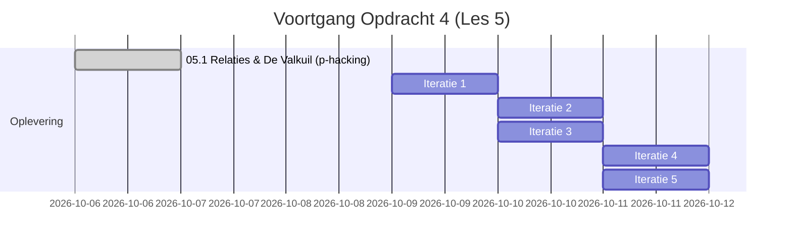

# To-Do Lijst: Vierde Visualisatieopdracht (MADS-DAV)
*Thema: Relaties, en wat maakt dat je er eentje gelooft ("Relationships, and what makes one believable")*

---

## Kernprincipe & Onderzoeksvraag Les 5
> **Centrale filosofie Les 5:** Een statistisch verband of correlatie vinden is tegenwoordig een koud kunstje. De cruciale stap die bijna iedereen overslaat is: **bepalen of wat je hebt gevonden wel echt is vóórdat je het opschrijft.**  
> Een geloofwaardige bevinding rust altijd op **drie pijlers**:
> 1. **Bewijs (Evidence):** Getoetst op de juiste eenheid van de claim, met een effectgrootte en steekproefomvang die toeval uitsluit.
> 2. **Mechanisme (Mechanism):** Een inhoudelijke, logische verklaring waarom het waar is. *Geen enkele hoeveelheid data kan dit vervangen.*
> 3. **Replicatie (Replication):** Houdt het patroon ook stand waar je nog niet had gekeken (andere persoon, ander kanaal, ander perspectief)?

---

## Definitieve Onderzoeksvraag & Bevinding voor Opdracht 4
> **Onderzoeksvraag:** *"In hoeverre beïnvloedt de berichtlengte van de partner de reactietijd van de ontvanger, en openbaart een Lowess-curve een non-lineair kantelpunt tussen snelle ping-pong reflexen en cognitieve vertraging?"*  
>
> **De Drie Pijlers in dit onderzoek:**
> 1. **Bewijs (Evidence):** Analyse over de volledige 4-jarige chatgeschiedenis met $N = 2.838$ directe interacties ($1.400$ reacties van Jeffrey, $1.438$ van Rick). Zowel Pearson ($p < 0,0001$) als Spearman correlaties zijn hoogsignificant. Toeval is uitgesloten.
> 2. **Mechanisme (Mechanism):** Korte berichten (1–10 woorden) functioneren als directe reflexantwoorden ("Oké", "Is goed"); de wachttijd blijft volstrekt vlak op ~1 à 2 minuten. Vanaf $\approx 12$ woorden treedt een cognitieve vertragingsdrempel op: de ontvanger moet de tekst aandachtig lezen en een doordacht antwoord formuleren, waardoor de reactietijd 4× tot 6× omhoog schiet naar 8 tot 13 minuten.
> 3. **Replicatie (Replication):** Beide partners vertonen exact hetzelfde kantelpunt bij 12 woorden en dezelfde curvevorm, ondanks een niveauverschil in basissnelheid (Rick's reflex is ~1,0 min, Jeffrey's reflex ~2,2 min).

---

## Het Ontwerp- en Iteratieproces van Opdracht 4

### Iteratie 1: De Thailand Tijdlijn-hypothese *(Verworpen wegens falsificatie)*
* **Het oorspronkelijke idee:** Onderzoeken of de reactietijd tijdens de Thailand-reis afweek van de 4-jarige baseline (trager in de ochtend door HAN-onderwijstaken, sneller in de namiddag vanuit het hotel in Bangkok).
* **Wat we deden:** Een 24-uurs tijdlijn gebouwd met een Lowess-curve om een kruising tussen beide condities rond 13:00 uur aan te tonen.
* **Waarom verworpen? (Wetenschappelijke integriteit):**
  * De formele permutatietoets leverde $p = 0,912$ (avond) en $p = 0,705$ (ochtend).
  * *Conclusie:* Het vermeende verschil berustte puur op toeval (de steekproef van de 2-weekse reis was te klein voor statistische hardheid).
  * *Besluit:* Hypothese direct verworpen om *p-hacking* te voorkomen. Terug naar de tekentafel voor een robuust verband over de gehele chatgeschiedenis.

### Iteratie 2: De Pivot naar Berichtlengte vs. Reactietijd *(Fundament gelegd)*
* **De nieuwe hypothese:** De cognitieve belasting van de zender bepaalt de wachttijd van de ontvanger: lange berichten vergen meer lees- en formuleertijd dan korte reflex-antwoorden.
* **Data-engineering in `01.3`:**
  * `ReplyWordCountAggregator` (`TransformBase`) gebouwd om uitsluitend inhoudelijke woorden te tellen via regex `\b[a-zA-Z0-9_À-ÿ]+\b` (emoticons, leestekens en media uitgefilterd).
  * Gekoppeld aan $N = 2.838$ directe 1-op-1 reacties ($1.400$ voor Jeffrey, $1.438$ voor Rick) over de volledige 4-jarige baseline.
  * Opgeslagen in een apart bestand `data/processed/chat-replies-words.parq` (waardoor eerdere opdrachten `02.5`, `03.3` en `04.4` 100% onaangeroerd bleven).
* **Statistisch bewijs (Pijler 1):**
  * Jeffrey: $n = 1.400$, Pearson $r = +0,116$, $p = 1,4 \times 10^{-5}$
  * Rick: $n = 1.438$, Pearson $r = +0,130$, $p = 9,3 \times 10^{-7}$
  * Toeval is wiskundig uitgesloten ($p < 0,0001$).

### Iteratie 3: Het Eerste Duopaneel Ontwerp *(Twee losse subplots)*
* **De opzet:** Twee subplots naast elkaar: Paneel A (Jeffrey reageert op Rick) en Paneel B (Rick reageert op Jeffrey als replicatietoets).
* **Grafische keuzes:**
  * Wiskundige $\log_{10}$-as voor reactietijd ($10^{-1} = 6\text{s}$ tot $10^{1.5} \approx 32\text{m}$).
  * X-as van 1 tot 60 woorden.
  * Vier lagen: grijze achtergrondpuntenwolk ($2.800$ stippen), binned medianen, gestippelde lineaire regressie (`order=1`) en doorgetrokken Lowess-curven.
* **Feedback van Jeffrey:**
  1. *De Y-as band onder $10^{-0.5}$ is leeg:* Loze witruimte onderin.
  2. *Redundant & cognitieve frictie:* Twee aparte panelen voelen alsof je naar twee dezelfde grafieken kijkt; je moet steeds met je ogen heen en weer schakelen.
  3. Kruisende annotatiepijlen maakten het visueel druk.

### Iteratie 4: Samenvoegen naar Één Enkel Paneel *(Directe vergelijking)*
* **De verandering:** Beide partners in **één gecombineerde visualisatie** geplaatst.
* **Waarom dit beter werkt:**
  * Je ziet direct het *niveauverschil* én de *vormovereenkomst*:
    * Jeffrey (oranje) heeft een reflex van ~2,2 min en stijgt naar 13 min.
    * Rick (blauw) heeft een snellere reflex van ~1,0 min en stijgt naar 8 min.
  * De **replicatie** wordt in één oogopslag zichtbaar: beide lijnen knikken op exact hetzelfde punt omhoog (rond 12 woorden).
  * Een subtiele lichtgrijze achtergrondband toegevoegd over 1–11 woorden om de "ping-pong reflexzone" af te bakenen.

### Iteratie 5: Feedback van de Proeflezer & Definitieve Verfijning *(Definitieve versie)*
* **Feedback van de externe lezer & verwerkte verbeteringen:**
  1. *De grijze achtergrondstippen leiden af:*
     * **Actie:** Achtergrondpunten volledig verwijderd. De grafiek is direct een oase van rust; alle focus ligt op de twee vloeiende Lowess-curven.
  2. *Moeite met de wiskundige $10$-machten op de Y-as:*
     * **Actie:** Labels als `(10⁰·³)` vervangen door vertrouwde, ronde tijden (**1 min, 2 min, 5 min, 10 min, 20 min**). De Y-as titel benoemt netjes: `Reactietijd ontvanger (minuten, log-schaal)`.
  3. *5 bollen voelde als te weinig data:*
     * **Actie:** Aantal bollen uitgebreid naar 9 fijnmazige woordgroepen en visueel naar de achtergrond gedrukt (`alpha=0.50`, `zorder=3`, kleiner formaat), zodat ze de Lowess-lijnen ondersteunen zonder te schreeuwen.
  4. *De tekstblokjes stonden rechts omgekeerd en de X-as liep te ver door:*
     * **Actie:** Badges gewisseld (Rick boven, Jeffrey onder), naar links gehaald (`ha="right"`), waardoor de X-as strak en compact kan stoppen bij **36 woorden** (maximale zoom op het relevante bereik van 1 t/m 35 woorden).
  5. *Titel, subtitel en legenda geïntegreerd:*
     * **Actie:** 2-regelige koptekst gecreëerd waarin direct de visuele legenda staat: *― Jeffrey (oranje) &nbsp; ― Rick (blauw) &nbsp; ┆ Omslagpunt bij 12 woorden*.
     * Anglicismen als "binned medianen" vervangen door keurig Nederlands in de methodologische voetnoot.

---

## Status van de Notebooks & Bestanden

* [x] **Notebook `01.3-your-own-chat_jeffrey.ipynb`:**
  * Oude `DailyResponseAggregator` vervangen door `ReplyWordCountAggregator`.
  * Schone woordentelling via regex `\b[a-zA-Z0-9_À-ÿ]+\b` (excl. emoticons/leestekens/media).
  * Veilig weggeschreven naar `data/processed/chat-replies-words.parq` ($N = 2.838$ reactieparen).
  * Geen impact op `02.5`, `03.3` en `04.4` (blijven `chat-20260915-190537.parq` laden).
* [x] **Notebook `05.6-your_turn_jeffrey.ipynb`:**
  * Definitieve visualisatie geïmplementeerd in cel `c05`.
  * Eén rustig canvas (11.0 × 6.0) met twee Lowess-lijnen (oranje Jeffrey, marineblauw Rick).
  * 2-regelige header met geïntegreerde legenda.
  * Y-as op begrijpelijke minuten (1, 2, 5, 10, 20 min, log-schaal), X-as strak afgebroken op 36 woorden.
  * Uitgebreide wetenschappelijke reflectie over Gestalt, preattentive processing, log-schaal, cognitief mechanisme en replicatie in cel `c06`.
* [x] **Afbeeldingen:**
  * Opgeslagen als `img/figuur4_relatie_woordlengte_reactietijd.png` (en kopie `img/figuur4_relatie_volume_reactietijd.png`).

---

## Voortgangsoverzicht Les 5

---

## Belangrijke Bestanden & Links

* **Jouw vertaalde notebooks voor Les 5:**
  * [01.3-your-own-chat_jeffrey.ipynb](file:///C:/Users/jajphalt/DAV/notebooks/lesson1/01.3-your-own-chat_jeffrey.ipynb)
  * [05.1-relationships jeffrey.ipynb](file:///C:/Users/jajphalt/DAV/notebooks/lesson5/05.1-relationships%20jeffrey.ipynb)
  * [05.2-correlation jeffrey.ipynb](file:///C:/Users/jajphalt/DAV/notebooks/lesson5/05.2-correlation%20jeffrey.ipynb)
  * [05.3-covid-modelling jeffrey.ipynb](file:///C:/Users/jajphalt/DAV/notebooks/lesson5/05.3-covid-modelling%20jeffrey.ipynb)
  * [05.4-covid-solution jeffrey.ipynb](file:///C:/Users/jajphalt/DAV/notebooks/lesson5/05.4-covid-solution%20jeffrey.ipynb)
  * [05.5-how-people-type jeffrey.ipynb](file:///C:/Users/jajphalt/DAV/notebooks/lesson5/05.5-how-people-type%20jeffrey.ipynb)
  * [05.6-your_turn_jeffrey.ipynb](file:///C:/Users/jajphalt/DAV/notebooks/lesson5/05.6-your_turn_jeffrey.ipynb)
* **Gegenereerde Visualisatie:**
  * [img/figuur4_relatie_woordlengte_reactietijd.png](file:///C:/Users/jajphalt/DAV/img/figuur4_relatie_woordlengte_reactietijd.png)
