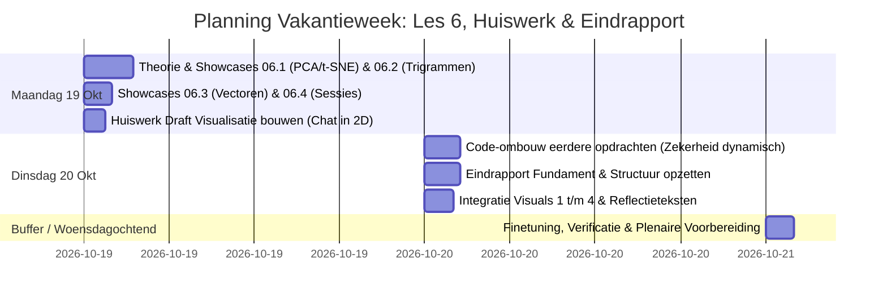

# To-Do Lijst: Vijfde Visualisatieopdracht & Eindrapport (MADS-DAV)
*Thema: Hoogdimensionale Ruimten, Vectorruimten & Embeddings ("High dimensional spaces: PCA vs. t-SNE, vector spaces & embeddings")*

---

## 1. Kernbegrip & Centrale Filosofie van Les 6
> **Centrale filosofie Les 6:**  
> Een tekstbericht of hoogdimensionale dataset heeft tientallen tot honderden dimensies. Mensen kunnen niet verder kijken dan 2D of 3D.  
> Twee methoden drukken die ruimte plat tot een beeld dat we kunnen zien, maar beide maken fundamentele keuzes:
> 1. **PCA (Lineair & Globaal):** Zoekt de schaduw die de meeste variantie behoudt. De richting met de meeste spreiding is exact de richting waar de punten het dichtst bij liggen (Pythagoras). Maar: *variantie heeft eenheden* (zonder standaardiseren wint de kolom met grote getallen) en PCA kan een gekromde ruimte (swiss roll) nooit ontrollen.
> 2. **t-SNE (Niet-lineair & Lokaal):** Zorgt dat directe buren in hoge dimensies ook buren blijven in 2D. Het ontrolt een gekromde structuur (de manifold), maar *geeft de globale geometrie op*: afstanden tussen verre clusters en de grootte van gaten betekenen niets.
> 
> **De Gouden Regels voor de Chat:**
> * *"Wat is één rij?"* Losse berichtjes ("haha", "oké") bevatten nauwelijks semantische lading en clusteren tot een vormloze klont. Samenvoegen tot inhoudelijke **gesprekssessies** (met de wachttijddrempel gefit uit Les 4) is de cruciale eerste stap.
> * *Stijl vs. Inhoud:* Karakter-trigrammen (`CountVectorizer`) meten *hoe* iemand typt (leestekens, gewoonte, links); sentence embeddings (`sentence-transformers`) meten *wat* er inhoudelijk gezegd wordt. Race ze tegen elkaar vóórdat je een conclusie trekt!
> * *Rapporteer eerlijk:* Rapporteer altijd de verklaarde variantie (Scree plot bij PCA) of een perplexity-sweep met numerieke silhouette-scores op echte vs. geschudde labels bij t-SNE. Cluster nooit de 2D-projectie, maar de oorspronkelijke data.

---

## 2. De Officiële Huiswerk- & Beoordelingsopdracht
> **De Huiswerkopdracht (Draft vóór Les 6):**  
> *"Before lesson 6 starts, make a first visualisation of your chat as points in a space: turn messages into vectors any way you can (word counts, tf-idf, an embedding) and reduce them to two dimensions, on your own and without the theory yet. Lesson 6 opens with everyone's drafts on the screen; that discussion is your feedback. Fix what you learned during the lesson and that evening, and hand the result in for grading at lesson 7 (Graded visualisation 5). The draft itself is not graded. The checklist behind the link is what the graded version will be held to."*
>
> **De Definitieve Beoordeling (Graded Visualisation 5 voor Les 7):**  
> Na de feedback in Les 6 verfijnen we de visualisatie volgens de strenge academische checklist:
> 1. Expliciete verantwoording van "wat is één rij" (sessievorming).
> 2. Verantwoording van schaling / normalisatie (lengte-afhankelijkheid vs. richting / cosinus).
> 3. Een getal dat geen plaatje is (1-NN baseline in hoge dimensies, silhouette t.o.v. geschudde labels).
> 4. Eerlijke rapportage van de projectiebeperkingen (Scree plot / perplexity sweep).
> 5. Grafische perfectie volgens Schwabish & Tufte (*Grey First*, directe labels, open spines, hoge data-ink ratio).

---

## 3. Realistische Tijdsinschatting & Planning Vakantieweek

In totaal vragen de doelstellingen circa **10 tot 12 uur** geconcentreerde arbeid. Dit laat zich uitstekend verdelen over **twee volle werkdagen** (maandag 19 en dinsdag 20 oktober) plus eventueel een kort reserve-dagdeel voor afronding en bezinking.

---

## 4. Stappenplan per Dag & Dagdeel

### DAG 1: Maandag 19 Oktober (Focus: Les 6 Begrijpen & Huiswerk Draft)
*Geschatte tijd: 6,5 tot 7 uur*

#### Ochtend (09:00 – 12:30): Dimensionaliteitsreductie & Stijlometrie
* [ ] **Stap 1: Notebook `06.1-dimensionality_reduction jeffrey.ipynb` doorlopen (2,0 uur)**
  * Begrijpen wat PCA zoekt: de lijn van maximale variantie is de lijn met minimaal kwadratisch verlies (Pythagoras).
  * SVD ontrafelen: richtingen ($V^T$, orthogonaal en genormaliseerd), spreiding ($\Sigma$, singuliere waarden), posities ($U$).
  * De Pinguïns-valkuil: waarom 99,99% verklaarde variantie door lichaamsgewicht in grammen een fout is, en hoe `StandardScaler` dit oplost (PC1 = grootte, PC2 = snavelvorm).
  * De Swiss Roll & Manifold-hypothese: waarom een platte schaduw (PCA) faalt op gekromde ruimten en waarom t-SNE buren bewaart.
  * MNIST (784 pixels) & de Scree plot (waarom 17% verklaarde variantie eerlijk in de titel hoort).
  * Perplexity doorgronden: lidmaatschap overleeft een sweep, geometrie (gaten en afstanden) niet.
  * Ruis-experiment: waarom je *nooit* de 2D-embedding moet clusteren, maar altijd de ruwe data.
* [ ] **Stap 2: Notebook `06.2-modelling jeffrey.ipynb` doorlopen (1,5 uur)**
  * Tekst omzetten naar getallen met `CountVectorizer(analyzer="char", ngram_range=(3, 3))`.
  * Waarom gelijke chunkgroottes verplicht zijn bij de Manhattan-afstand (som van absolute verschillen).
  * De QAnon-showcase: waarom de eerste twee maanden afwijken (Socratische vragen vs. geplakte platform-links).
  * Verificatie vóór claim: markup wegfilteren en controleren of het stijlverschil standhoudt.
  * Eerste test op eigen chat met Rick: scheidt typstijl in chunks van 500 tekens jullie als auteurs?

#### Middag (13:30 – 17:00): Vectorruimten, Sessies & De Huiswerk Draft
* [ ] **Stap 3: Notebook `06.3-vectorspaces jeffrey.ipynb` doorlopen (1,0 uur)**
  * Georganiseerde vectorruimten: encoders (`dinov2-small`) en caches (`VectorCache.from_hub`).
  * Cosinus-similariteit vs. Euclidische afstand: waarom hoek/richting telt en lengte genegeerd wordt.
  * De 1-Nearest-Neighbour baseline zonder training: het benchmark-getal in 384D dat elke methode moet verslaan.
* [ ] **Stap 4: Notebook `06.4-your-own-vectors jeffrey.ipynb` doorlopen (1,0 uur)**
  * Het probleem van de losse berichten ("haha" = inhoudsloze klont).
  * Drie manieren om "één rij" te definiëren: Fixed window, Per dag, en Tijdsinterval-sessies (`sessionize`).
  * De wachttijddrempel koppelen aan de exponentiële verdeling uit Les 4 (~15-20 minuten drempelwaarde).
  * Self-supervised split-half check op de samengevoegde eenheden.
  * De race tussen trigrammen (stijl) en sentence-embeddings (inhoud).
* [ ] **Stap 5: De Huiswerk Draft Maken (1,5 à 2,0 uur)**
  * Een eerste ongegradeerde visualisatie maken van jullie chat (bijv. in een aparte scratch-cel of apart concept-notebook).
  * Berichten omzetten naar een 2D-ruimte (bijv. via TF-IDF of een sentence-embedding) en projecteren (PCA of t-SNE).
  * Een korte notitie schrijven voor de plenaire sessie in Les 6: wat valt op, wat klontert samen, en welke beperkingen zien we nu al met het blote oog?

---

### DAG 2: Dinsdag 20 Oktober (Focus: Eindrapport & Code-ombouw eerdere opdrachten)
*Geschatte tijd: 6,5 tot 7 uur*

#### Ochtend (09:00 – 12:30): Dynamische Zekerheidsberekeningen (Code-ombouw)
* [ ] **Stap 6: Ombouw eerdere opdrachten — Geen hardcoded prints meer (2,5 uur)**
  * *Doel:* Zorgen dat alle gerapporteerde statistieken (steekproefgroottes $N$, p-waardes, correlaties, betrouwbaarheidsintervallen, medianen) 100% dynamisch berekend worden vanuit de data en via nette f-strings of dataclasses in de annotaties, titels en bijschriften vloeien.
  * **Opdracht 1 & 2 (`02.5-your_turn_jeffrey.ipynb`):**
    * Aantallen berichten per dagdeel, percentages en dagritmes dynamisch formatteren.
  * **Opdracht 3 (`04.4-before-and-after jeffrey.ipynb`):**
    * Parameters van de negatief-binomiale fit (gemiddelde, variantie, $r$, $p$) en de nulplot-permutatie p-waarde ($p < 0,001$) dynamisch koppelen aan de plotvariabelen.
  * **Opdracht 4 (`05.6-your_turn_jeffrey.ipynb`):**
    * Steekproefgrootte $N = 2.838$ ($1.400$ vs $1.438$), Pearson $r$-waarden, $p$-waarden en Lowess-omslagpuntcoördinaten direct uit de data trekken.
  * *Verificatie:* Notebooks opnieuw 'Run All' draaien en controleren dat geen enkele bewering losstaat van de actuele data.

#### Middag (13:30 – 17:00): Eindrapport Fundament & Integratie Opdracht 1 t/m 4
* [ ] **Stap 7: Architectuur & Structuur Eindrapport opzetten (1,5 uur)**
  * Aanmaken van het hoofddocument (bijv. `eindrapport.md` of Quarto/Jupyter-structuur volgens HAN-richtlijnen).
  * Inrichten van de academische structuur:
    1. **Inleiding & Databeschrijving:** 4 jaar WhatsApp-communicatie tussen Jeffrey en Rick (>6.400 berichten, $N=2.838$ reactieparen).
    2. **Hoofdstuk 1: Categorieën, Tijd & Simpsons Paradox (Opdracht 1 & 2):** Het basispatroon van interactie.
    3. **Hoofdstuk 2: Kansverdelingen & Exogene Schokken (Opdracht 3):** De Thailand-reis als natuurlijke interventie; verschuiving in dagvolume en wachttijden.
    4. **Hoofdstuk 3: Relaties & Cognitieve Mechanismen (Opdracht 4):** Berichtlengte vs. reactietijd; de reflexzone vs. de 12-woorden vertragingsdrempel.
    5. **Hoofdstuk 4: Hoogdimensionale Ruimten & Stijlometrie (Opdracht 5 - Ruimtehouder):** Conceptuele opzet van sessies en embeddings.
    6. **Synthese & Methodologische Reflectie:** Lessen over Gestalt, preattentive processing, Tufte/Schwabish ontwerpprincipes en wetenschappelijke falsificatie (verwerpen van spurious correlations).
* [ ] **Stap 8: Definitieve Figuren & Reflecties Inbedden (1,5 uur)**
  * Controleren dat de definitieve afbeeldingen in `img/` kraakhelder en up-to-date zijn:
    * `img/dagritme_vergelijking.png` / Barbell-plot
    * `img/figuur3_verdelingen_voor_na.png` (Opdracht 3)
    * `img/figuur4_relatie_woordlengte_reactietijd.png` (Opdracht 4)
  * Tekstuele toelichting en bijschriften schrijven waarin per figuur de Drie Pijlers (Bewijs, Mechanisme, Replicatie) helder zijn uitgewerkt.

---

### DAG 3 (Optioneel / Buffer: Woensdagochtend 21 Oktober)
*Geschatte tijd: 2 tot 3 uur*

* [ ] **Stap 9: Controle & Voorbereiding Plenaire Les 6**
  * Laatste check van de Huiswerk Draft: kan Jeffrey in eigen woorden uitleggen hoe zijn vectoren gemaakt zijn en waarom de projectie er zo uitziet?
  * Toetsen aan `checklist.md`: preattentive processing, Gestalt, 'start with grey', open spines, en eerlijke claim-afbakening.
  * Notities klaarleggen met vragen voor Raoul tijdens de feedbacksessie van Les 6.

---

## 5. Checklist vóór Definitieve Inlevering (Opdracht 5 / Les 7)
* [ ] Is "één rij" verdedigbaar gedefinieerd (tijdsinterval-sessies i.p.v. losse "haha"-berichten)?
* [ ] Is de keuze voor cosinus-similariteit vs. Euclidisch/Manhattan onderbouwd aan de hand van vectorlengtes?
* [ ] Bevat de PCA-plot een Scree plot (verklaarde variantie) in het bijschrift?
* [ ] Is bij t-SNE een sweep van perplexities getoond en getoetst met numerieke silhouette-scores (echte vs. geschudde labels)?
* [ ] Is er een getal gerapporteerd in de oorspronkelijke hoogdimensionale ruimte (zoals een 1-NN baseline)?
* [ ] Wordt de data geclusterd en niet de 2D-projectie?
* [ ] Voldoet de grafiek aan Schwabish & Tufte (geen losse legendabox, neutrale basiskleuren, signaalkleur voor de claim)?
